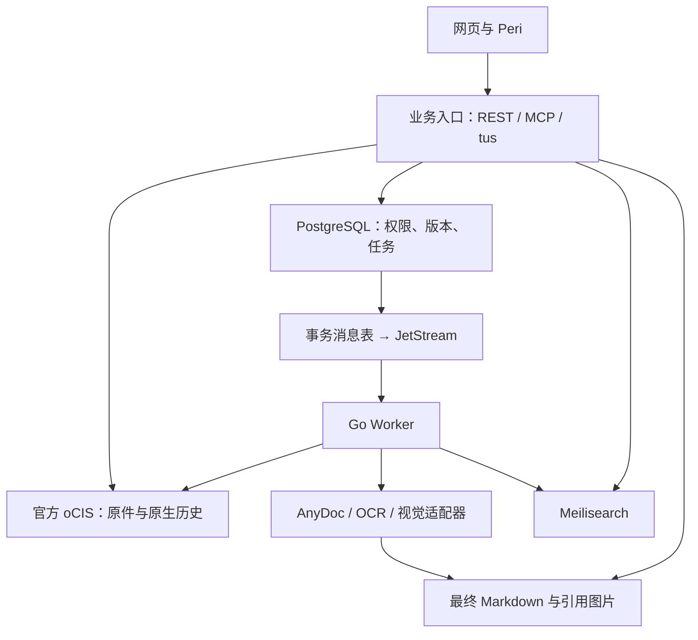
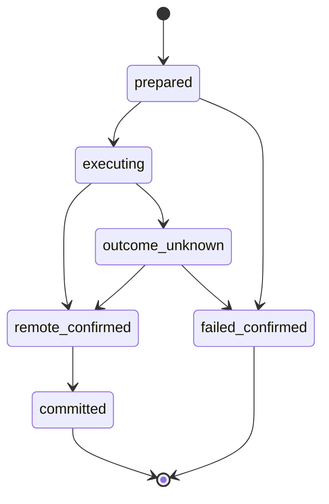
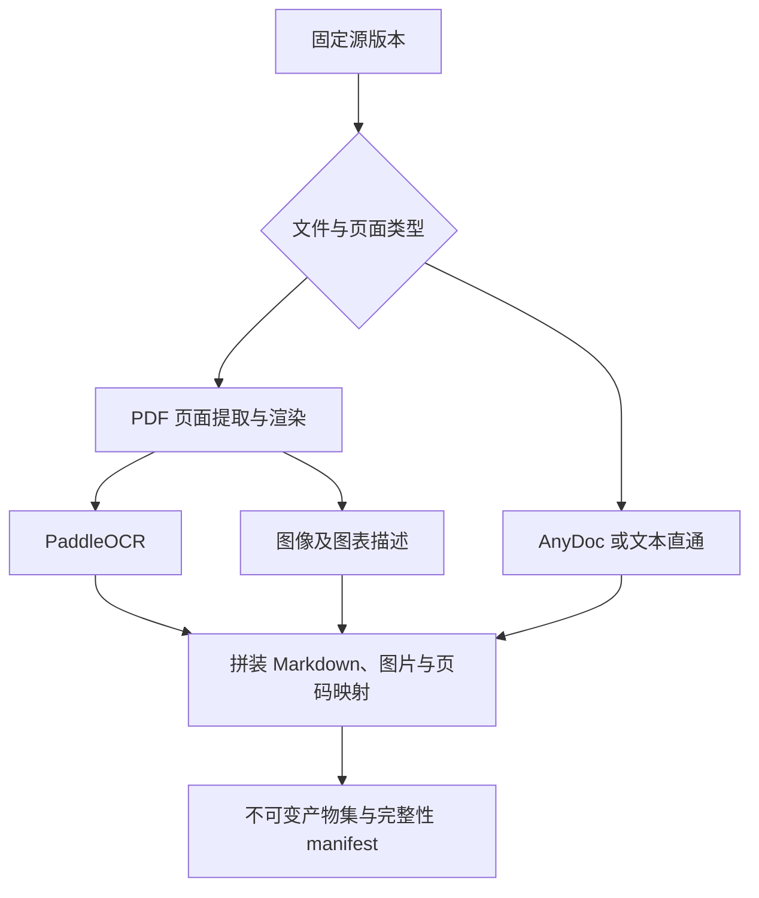

# Agent CloudDrive 一期工程交接报告

版本：v1.0  
日期：2026-10-23  
用途：交给后端、前端、转换服务与部署工程师直接拆分任务。  
状态：需求与工程方案已整理；尚未实现代码、部署系统或执行验收测试。

## 1. 开工结论与阅读指引

可以开工。现有产品决策足够支撑一期开发，不需要再进行一轮通用需求问卷。工程团队先完成 M0 集成验证，再实现“上传原件 → 固定源版本 → 转换 Markdown → 索引 → MCP 检索读取”的闭环。

本报告使用三种标记：

| 标记 | 含义 | 执行方式 |
| --- | --- | --- |
| 已确认 | 用户已经明确选择的产品规则或技术选型 | 直接实施，不重新询问 |
| 工程默认 | 为使方案可落地补充的接口、状态与实现约定 | 可由团队细化，不能改变已确认行为 |
| 待验证 | 依赖具体版本或第三方实际接口的集成点 | 先做验证；不通过时记录阻塞，不能默认能力存在 |

**一期交付的是适合 Agent 使用的云盘。** 网页负责文件管理、搜索、原件预览与授权确认；Agent 通过 MCP 读写自己的个人空间，并在外部完成分析、问答和报告生成。

**一期明确不做：** 跨用户原件去重、跨用户转换结果复用、语义向量检索、网页 AI 问答、目录分享、桌面同步和公开挂载入口、历史永久删除入口、灾备方案、跨节点上传接管、多节点实测或容量性能承诺。

多台机器同时工作的能力保留在设计与配置中；一期只验收单机 Docker Compose。大文件专项只安排一次 Uppy + tus 的 10 GiB 断网续传测试。

实施者建议按以下顺序阅读：

| 角色 | 优先阅读 |
| --- | --- |
| 技术负责人 | 第 2–4、16–19 节 |
| 后端工程师 | 第 4–11、13–15 节 |
| 前端工程师 | 第 5、7、10–12、18 节 |
| 转换服务工程师 | 第 6、8–9、15、18 节 |
| 部署与验收工程师 | 第 3–4、13、15–19 节 |

## 2. 已确认需求基线

| 编号 | 主题 | 一期必须满足的规则 |
| --- | --- | --- |
| R01 | 上传与索引 | 原件先保存到云盘；异步转换为 Markdown 和必要图片，再建立 Meilisearch 文本索引 |
| R02 | 数据关联 | 索引携带原始文件路径标签，同时用稳定文件 ID、源版本 ID 关联；不能只靠路径 |
| R03 | 默认权限 | 未分享文件只有所有者可以搜索、读取与下载 |
| R04 | Agent 范围 | OAuth 授权整个自有个人空间；仅可缩小操作权限，默认全部勾选 |
| R05 | 收到的分享 | Agent 不得搜索、读取仅由他人分享给该用户的文件 |
| R06 | Agent 写操作 | 支持创建文件、保存产物、覆盖形成新版本、删除、恢复、移动、重命名与目录整理 |
| R07 | 并发修改 | 后保存者收到版本冲突，读取最新版后重新修改；不得静默覆盖 |
| R08 | 批量操作 | 独立项目继续执行，最终分别返回成功项和失败项 |
| R09 | 版本与引用 | 每个源版本具有时间标签和唯一 ID；引用固定具体源版本，支持历史审核 |
| R10 | 新版处理中 | 所有者可搜索旧的可用转换内容；明确显示返回版本及新版处理中 |
| R11 | 匿名反馈 | 反馈表独立于文件表；完全不保存提交者身份及可关联来源 |
| R12 | 反馈使用 | 仅后台排查，不进入 Agent 读取、转换正文和搜索结果 |
| R13 | 删除与保留 | 删除只隐藏；原件历史、最终转换产物、必要引用图片与反馈长期保留 |
| R14 | 业务回收站 | 使用官方 oCIS MOVE 移入保留目录，由业务层管理删除和恢复 |
| R15 | 恢复冲突 | 目标路径被占用时返回冲突，由用户或 Agent 指定新路径 |
| R16 | 分享对象 | 单文件可分享给指定系统用户、用户组或未登录链接访问者 |
| R17 | 分享能力 | 内部分享只读与下载；匿名链接只提供原件预览 |
| R18 | 分享版本 | 默认仅当前最新版；历史版本需要另外显式授权 |
| R19 | 分享确认 | Agent 每一次分享都要用户确认；删除或账号停用使分享失效，恢复后需重新确认 |
| R20 | 转换能力 | 尽量覆盖 AnyDoc 支持的格式；扫描 PDF 需 OCR，图片及图表描述一起纳入搜索 |
| R21 | 转换适配器 | 转换器独立容器、内部 HTTP 调用，可增加或替换适配器 |
| R22 | 部分成功 | 成功页可搜索读取，明确标注未完成和缺失页码 |
| R23 | 转换限制 | 超过自动转换上限仍保存原件，标记未转换；调整配置后允许重试 |
| R24 | 转换升级 | 新上传使用新配方；旧文件只在手动请求后重新转换 |
| R25 | 外部模型 | OCR、视觉服务是否走外部网络由后端配置决定 |
| R26 | 账号体系 | 使用外部身份系统；附 Keycloak 参考部署，支持符合接入要求的替代方案 |
| R27 | 停用账号 | 拒绝访问并停用其所有公开链接和内部分享；保留文件和审核历史 |
| R28 | 存储选择 | 环境变量统一选择本地或 S3；不同内容类别使用独立目录、桶或前缀 |
| R29 | 配额 | 仅计算各文件最新原件大小；回收站继续计入；历史及派生产物不计个人逻辑配额 |
| R30 | 去重 | 一期不做原件去重与跨用户转换复用；不为此修改 oCIS |
| R31 | 官方组件 | 使用官方 oCIS 镜像；不维护 oCIS 存储扩展或定制镜像 |
| R32 | 部署与上传 | 单机 Compose 验收；设计支持多机器；接收节点宕机可导致此次上传失败并重新上传 |

R30 是对前期去重讨论的最终收敛，优先于早期“跨用户只存一份”“复用其他用户转换结果”的设想。备份恢复目标已明确暂缓，不作为一期阻塞。

## 3. 技术选型与服务划分

### 3.1 选型表

| 层 | 采用方案 | 状态与边界 |
| --- | --- | --- |
| Go HTTP 后端 | CloudWeGo Hertz | 工程默认，回应字节系框架偏好；业务先保持模块化单体 |
| MCP | 官方 Go MCP SDK，Streamable HTTP | 工程默认；首个联调客户端为 Peri，兼容性待实测 |
| 数据库 | PostgreSQL | 已确认；业务事实、任务状态、版本关系、配额、权限与事务消息表 |
| 数据访问 | sqlc + pgx | 已确认；SQL 与迁移纳入版本管理 |
| 消息 | NATS JetStream | 已确认；至少一次投递，消费者必须幂等 |
| 云盘内核 | 官方 oCIS | 已确认；原件、原生目录与历史内容读写 |
| 默认对象存储 | RustFS 的 S3 接口 | 已确认；使用免费开源组件；不承诺或依赖去重 |
| 搜索 | Meilisearch | 已确认；关键词全文索引，不启用向量检索 |
| 前端 | React + Vite + Ant Design | 已确认；独立前端 |
| 大文件上传 | Uppy + tus | 已确认；经业务受控入口连接 oCIS 原生上传能力 |
| 预览 | kkFileView + 受控预览适配层 | 已确认方向；匿名预览限制由业务层实现 |
| 身份 | Keycloak 参考部署 + IdentityAdapter | 已确认；不自建账号系统 |
| 常规转换 | Firecrawl AnyDoc HTTP 适配器容器 | 已确认；AnyDoc 本身不等于完整 OCR/图片管线 |
| OCR | PaddleOCR CPU 容器 | 已确认；不承诺长文档吞吐 |
| 图片与图表描述 | 已有视觉模型 HTTP 服务 | 已确认；环境变量配置地址、凭据与模型 |
| 交付 | Docker Compose | 已确认；一期单机验收，附分节点配置说明 |

具体镜像 tag、digest、Go/npm 依赖版本在 M0 兼容性验证后写入锁定清单。正式交付不能使用未固定的 `latest`。本报告查阅的 oCIS 资料以 8.2 系列为依据，不代表已完成该版本的整套联调。

### 3.2 运行模块

| 模块 | 责任 | 扩容方式 |
| --- | --- | --- |
| gateway | TLS、路由、上传流代理、受控资源入口 | 多实例，上传会话按拥有节点路由 |
| api | Hertz REST、授权、文件操作、上传准入、分享、MCP | 无业务会话状态的多实例 |
| worker | 转换编排、产物提交、索引发布 | JetStream 拉取消费，独立于 API 扩容 |
| maintenance | outbox 投递、远端操作对账、租约回收、临时数据清理 | 可作为 worker 运行模式；用数据库领取任务 |
| converter containers | AnyDoc、OCR、视觉适配器执行有界任务 | 按资源类型分别部署扩容 |
| preview adapter | 调用 kkFileView，管理预览产物和访问票据 | 与业务权限联动，可独立进程 |
| dependencies | PostgreSQL、NATS、Meilisearch、oCIS、RustFS、Keycloak | 一期单实例参考配置，不宣称整体高可用 |

MCP 可在 API 同一进程内使用独立的标准 `net/http` 监听器，再由网关统一路由。这样可以直接使用官方 SDK；不预设 Hertz 到 SDK 的流式适配已验证。

### 3.3 架构关系



oCIS、RustFS、Meilisearch、转换器和 kkFileView 均不向客户端暴露通用管理或读写接口。客户端持有的业务凭据不能直接绕过业务层访问原生云盘。

## 4. 存储职责与部署约束

### 4.1 每类数据的唯一职责

| 系统 | 保存什么 | 不承担什么 |
| --- | --- | --- |
| oCIS | 原件字节、原生资源身份、原生树与历史修订内容 | 自定义 Agent 权限、业务回收站状态、匿名反馈 |
| PostgreSQL | 业务文件 ID、原生映射、目录投影、权限、版本映射、转换任务、配额与操作记录 | 10 GiB 原件和完整图片二进制 |
| artifact store | 不可变最终 Markdown、必要图片、转换 manifest、受控预览派生文件 | 云盘原件目录的独立主副本 |
| Meilisearch | 可重建的分块正文与检索元数据 | 权限事实、唯一正文存储、历史审核唯一载体 |
| JetStream | 待处理事件及重投递 | 最终任务状态或唯一任务记录 |

数据库目录投影只能由已确认的官方 oCIS 操作更新。禁止同时通过另一套路径 API 私自修改原生目录。出现不一致，由操作记录与原生资源 ID 对账修复，不能靠覆盖数据库掩盖问题。

### 4.2 本地与 S3 两种模式

| 数据 | 本地模式 | S3 模式 |
| --- | --- | --- |
| oCIS 原件 | 官方 `ocis` 驱动独占的目录 | 官方 `s3ng` 驱动管理的原件桶 |
| oCIS 元数据 | 官方驱动的 POSIX 目录 | 仍需要 POSIX 元数据目录 |
| Markdown | artifact 根目录的 `markdown/` | artifact 桶的 `markdown/` |
| 引用图片 | `images/` | `images/` |
| manifest | `manifests/` | `manifests/` |
| 预览产物 | `previews/` | `previews/` |
| 未提交临时产物 | `tmp/{job}/{attempt}/` | 同类临时前缀，失败后可清理 |

业务环境变量 `DRIVE_STORAGE_MODE=local|s3` 统一选择内容后端。S3 参考部署使用一个 RustFS endpoint，给 oCIS 原件和业务产物使用不同桶；产物内部再分前缀。这样满足分类隔离，又不要求官方驱动支持自定义原件键布局。

**oCIS 原件键名由官方驱动管理。** 不直接修改、扫描重命名或用业务 SHA256 重排其内部对象。也不发明未经文档支持的“oCIS 原件前缀”参数。

S3 不是 oCIS 全部状态的替代品。`s3ng` 保留 POSIX 元数据；多机方案必须让相关实例访问兼容的共享元数据文件系统，参考 NFSv4。每台机器各挂一个独立本地 volume 不构成共享云盘。[S01][S02]

环境变量切换模式不会迁移已有数据。部署文档必须把“选择初始后端”和“数据迁移”分开；一期不提供在线迁移承诺。

### 4.3 长期保留与清理边界

长期保留：已提交源版本、已发布最终 Markdown、必要引用图片、被引用的旧转换代次、反馈，以及定位这些数据必需的元数据。

允许清理：未提交上传片段、失败尝试的临时目录、不再需要且未被引用的过程渲染、可重建的过期预览缓存。

不得为这些长期数据配置原生 revisions purge、对象存储生命周期删除或通用“孤儿对象清理”。业务回收站不能使用会被原生回收站清空的 DELETE 语义。官方原生历史清理能力确实会删除版本，需要在交付运行配置中明确禁止。[S03]

### 4.4 配额与上传预留

逻辑配额：

`used_bytes = SUM(每个拥有文件的最新已提交原件大小)`

求和包含业务回收站内的文件；目录不计大小。历史原件和派生产物不占个人逻辑配额，但占物理存储。两者必须分别展示或监控。

覆盖旧文件时预留 `max(new_size - old_size, 0)`；新建预留完整大小。提交成功后按实际新旧差额修改用量，再释放预留。同一文件同一时刻只允许一个尚未解决的内容提交操作。

配额检查和预留使用 PostgreSQL 事务与行锁；不在上传 10 GiB 的整个过程中持有事务。失败且已确认不会提交的会话可以释放预留；远端结果未知的会话要先对账，不能仅因超时就释放。

原生 oCIS 配额必须配置为不与业务算法冲突，且不能先行拒绝业务允许的历史保留。M0 验证该组合，业务配额是产品对外口径。

## 5. 身份、权限与分享

### 5.1 主体与授权

外部用户主键为 `(issuer, subject)`。邮箱和显示名可变，不用作授权键。首次登录建立业务主体和个人空间映射；oCIS 原生用户、空间创建与后端访问凭据由 IdentityAdapter/OcisAdapter 协作完成。

OAuth 文件范围始终是该用户拥有的整个个人空间。工程默认使用以下业务 scopes：

| scope | 权限 |
| --- | --- |
| `drive.read` | 列表、搜索、原件下载、版本与 Markdown 读取 |
| `drive.write` | 创建、上传、覆盖、目录创建、移动、重命名 |
| `drive.delete` | 移入业务回收站 |
| `drive.restore` | 恢复回收站内容 |
| `drive.convert` | 手动转换或重新转换 |
| `drive.share.request` | 创建分享待确认请求，不能直接批准 |
| `drive.feedback` | 提交匿名反馈；不意味着可以读取他人反馈 |

用户授权页默认全部勾选，可取消部分操作。搜索/读取是拥有关系、主体状态、scope 与文件生命周期的共同判断，不能只校验 scope。

历史读取属于 `drive.read` 的所有者能力；分享接收者必须具有额外的具体历史版本授权。后台审核入口使用单独的显式审核授权；普通管理员身份本身不授予文件内容读取权，不将私有文件加入普通管理员搜索结果，不给 Agent 默认审核权限。

### 5.2 OAuth 与 Peri 的实现边界

REST 与 MCP 共享业务授权服务。MCP 提供所选协议版本要求的授权元数据，验证 issuer、audience、resource、scope；客户端授权码流程使用 PKCE。具体 Peri 版本、MCP 协议版本和授权注册方式在 M0 锁定。[S12][S13]

CloudDrive 业务令牌不能直接当作 oCIS 令牌透传。Keycloak 参考部署可验证“同一 realm 内的标准 token exchange → 独立 oCIS audience”方案；这属于待验证的集成设计，不能把任意第三方 OIDC 服务都当成可直接替换。[S14]

后台 Worker 的原件读取必须使用服务端受控委托能力或绑定任务的短期读取票据；不能依赖浏览器 access token 在长任务结束前一直有效。该凭据策略必须同时满足源版本固定、主体停用拒绝访问、最小访问范围与凭据不入日志。

不把 oCIS 文档注明不适于生产的 auth-app 管理员 impersonation 选项作为默认方案。[S04]

替代身份服务至少要提供：OIDC/OAuth、稳定 subject、组标识与成员查询、账号状态查询或可信停用事件、符合本系统需求的后端委托访问方案。只支持登录并不足以替换完整 IdentityAdapter。

### 5.3 停用与撤销

一期工程默认：请求鉴权时检查业务停用状态，并通过 IdentityAdapter 获取所需主体的权威启用状态；不对“启用”状态做长期正缓存。公开分享还要检查分享创建者状态。状态服务不可用时，相关受保护读取失败关闭。

后台对账和停用事件负责将所有分享持久化停用。恢复账号仅恢复登录资格，不能自动恢复分享。用户组分享每次访问按当前组成员关系判断；移出组后旧缓存不能继续放行。

此方案不依赖“等 JWT 自然过期”。生产若引入状态缓存，必须单独定义并验收传播上限，不能继续声称即时停用。

### 5.4 分享与用户确认

| 入口 | 权限 | 默认源版本策略 |
| --- | --- | --- |
| 内部指定用户 | 只读、下载 | 当前最新版 |
| 内部用户组 | 只读、下载 | 当前最新版 |
| 未登录链接 | 受控原件预览 | 当前最新版 |
| 单独历史授权 | 明确接收者与允许操作 | 固定所选源版本 |

分享记录只绑定单个文件，不能绑定目录。历史授权可使用同一表的固定版本策略，但必须经过独立确认。

Agent 创建待确认请求，网页向用户展示文件、接收对象、权限、版本策略和有效期；用户确认后创建或更新分享。待确认请求应固定这些字段，防止确认后更换对象。请求默认 15 分钟过期是工程默认，可配置。

Agent 不获得 `approve` 能力。OAuth 的“全部权限”也不能绕过用户确认。恢复后的分享同样走新的确认。

链接 token 使用高熵随机值，仅在数据库存摘要；拒绝访问不泄露文件名、路径或是否存在。删除、账号停用、分享撤销和新版本替换均要影响后续预览资源请求，不只隐藏页面按钮。

## 6. 数据模型与不变量

### 6.1 四种标识必须分开

| 标识 | 含义 | 改变时机 |
| --- | --- | --- |
| `file_id` | 稳定业务文件身份 | 文件创建时产生，移动/重命名/覆盖不变 |
| `metadata_revision` | 路径、生命周期及写入并发控制版本 | 成功业务变更时递增 |
| `version_id` | 不可变原件内容版本 | 每次非幂等重复的内容提交成功时产生 |
| `artifact_set_id` | 某源版本的一次最终转换代次 | 初次转换或手动重转换发布时产生 |

版本时间使用服务端 UTC 时间。时间标签便于审核，但不作为唯一键；文件内另有单调递增 `version_seq`。同一字节内容再次正常覆盖也形成新逻辑版本；同一幂等请求的重试只返回原结果。

引用最少包含：

```json
{
  "file_id": "019a0000-0000-7000-8000-000000000001",
  "version_id": "019a0000-0000-7000-8000-000000000002",
  "artifact_set_id": "019a0000-0000-7000-8000-000000000003",
  "location": {"page": 12, "block": "p12-b04"}
}
```

路径和显示文件名随响应附带，不能用它们替代上述标识。引用不保存一次性下载 URL。

### 6.2 核心表

| 表 | 关键字段 | 约束与责任 |
| --- | --- | --- |
| `principals` | id、issuer、subject、status | issuer + subject 唯一；不管理密码 |
| `spaces` | id、owner_id、native_space_id、native_instance | 个人空间映射 |
| `files` | id、owner_id、space_id、parent_id、name、kind、lifecycle、metadata_revision、current_version_id、search_artifact_set_id、active_operation_id、native_resource_id | 原生资源完整元组唯一；有效同目录名称唯一 |
| `file_versions` | id、file_id、version_seq、committed_at、size、sha256、native_etag、native_revision_ref | file_id + version_seq 唯一；原件版本不可覆盖 |
| `artifact_sets` | id、source_version_id、generation、recipe_fingerprint、manifest_key、markdown_key、completeness、published_at | 发布后不可原地修改；旧代次保留 |
| `conversion_jobs` | id、source_version_id、recipe_snapshot、state、attempt、lease_token、lease_until、error | PostgreSQL 是任务状态事实 |
| `conversion_page_results` | job_id、page_no、stage、attempt、state、result_ref、error_code | 区分文字识别失败与图表描述失败 |
| `file_operations` | id、file_id、actor_principal_id、actor_type、kind、expected_revision、idempotency_key、intent、state、remote_result、retry_at | 记录跨 oCIS/数据库操作和未知结果 |
| `upload_sessions` | id、operation_id、expected_size、expected_version_id、native_upload_ref、node_id、state | 绑定授权与配额，不允许任意上传目标 |
| `quota_accounts` | owner_id、limit_bytes、used_bytes、reserved_bytes | 原子修改；计算口径见第 4 节 |
| `quota_reservations` | id、upload_id、bytes、state | 释放须依据已确认终态 |
| `trash_entries` | id、root_file_id、original_parent_id、original_name、original_path、reserved_location、deleted_at、state | 支持整目录作为一条回收记录；保留子项关系 |
| `share_approvals` | id、requester_principal、request_hash、request_body、expires_at、state | 正常实名审批记录，不与匿名反馈混用 |
| `share_grants` | id、file_id、audience_type、audience_id、token_hash、rights、version_policy、version_id、state、approved_by | 无目录分享；历史授权显式绑定版本 |
| `feedback` | id、file_id、version_id、artifact_set_id、category、body、received_day、triage_state | 不保存提交人、会话、IP、trace 或关联操作 ID |
| `outbox` | id、event_type、aggregate_id、payload、state、published_at | 与业务提交同事务写入 |
| `batch_operations / batch_items` | batch_id、item_id、depends_on、operation_id、status、result | 保存逐项状态；失败不回滚其他独立成功项 |

必要图片列表和页码映射可先放在版本化 manifest 中，不必给每种中间产物建立永久表。若增加 `artifact_items`，其权限继承文件，不能独立公开。

### 6.3 必须维持的数据库规则

1. 历史源版本、已发布产物和反馈不能被文件软删除级联删除。
2. `current_version_id` 与 `search_artifact_set_id` 分开：新版处理中时允许两者指向不同源版本。
3. 幂等键按主体、操作类型和键限定；同一键配不同请求体返回冲突。
4. 每次原件提交都保存原生版本引用映射；不能用当前路径临时拼出历史版本。
5. 同一文件的未知远端写入未解决前，不接受下一次覆盖、移动或删除。
6. 目录操作同时锁定或排斥受影响子树；子项访问必须检查祖先生命周期。
7. 业务路径统一为规范化绝对路径，拒绝 `..`、保留目录和无效编码。工程默认 Unicode NFC、大小写敏感；M0 校验与原生语义一致后固定，禁止自动改名掩盖冲突。
8. 匿名反馈表不得新增任何来源追踪字段，也不能通过普通 audit/outbox 记录间接关联提交者。

## 7. 上传、版本提交与文件操作

### 7.1 上传主流程

1. 网页或 MCP 创建上传会话，提交目标父目录/文件 ID、名称、字节数和预期版本。
2. API 校验主体、scope、路径、业务版本及配额，创建持久化操作和配额预留。
3. API 返回受控 tus URL、会话 ID 和过期时间；客户端不能指定任意 oCIS 路径。
4. Uppy 直接流式上传到受控 tus 入口。网关转发必要 tus 方法与响应头，不将整个文件读入 Go 内存。
5. 客户端上传完成后，后端验证原生提交结果、资源 ID、长度及必要完整性信息。网络响应丢失时从操作状态恢复。
6. 获取明确的原生内容版本引用；在一个 PostgreSQL 事务内写入新版本、更新当前指针与配额、建立转换任务和 outbox。
7. 原件可读取后立即返回“已保存，处理中”。转换不阻塞原件可用。
8. outbox 投递事件，Worker 执行固定源版本转换；索引就绪后再发布可搜索代次。

oCIS 文档中的内置上传后处理可使文件在处理期间不可访问，因此 OCR/视觉处理放在业务异步管线中，不能未经验证直接挂成阻塞式原生 postprocessing。[S05]

### 7.2 原生提交与数据库提交不是一个事务



`outcome_unknown` 表示不能判断原生操作是否已经生效。此状态下继续阻止冲突操作，按资源 ID、目标位置、ETag 或上传状态对账。超时不等于失败，不能立即另发同一替换请求。

outbox 解决数据库到消息系统的可靠投递，不会自动解决 oCIS 到数据库的一致性。远端已提交但数据库写入失败时，由持久化操作恢复版本映射、配额和任务记录，不能让用户重复上传形成意外覆盖。

### 7.3 并发覆盖

覆盖请求必须携带 `expected_version_id` 和 `expected_metadata_revision`，或者由对应 ETag 绑定这两者。预检通过后，**最终提交时还要保证比较条件仍然成立**。

若 oCIS 所选 tus 路径不能提供所需提交条件，M0 必须验证可用的官方接口组合与业务串行化方案；不能只在 tus 创建时检查一次，随后任意覆盖。也不能用会替换资源身份、丢失原生历史的 MOVE 技巧冒充解决方案。

冲突响应返回当前文件版本及元数据修订号，Agent 重新读取并自行合并。不自动合并文档，也不自动覆盖。

### 7.4 移动、重命名与目录

移动和重命名使用官方 oCIS 操作，业务层持久化意图、禁止冲突、确认原生结果再更新投影。成功后只增加元数据修订号，不创建新的内容版本。

移动目录不触发重新 OCR；更新受影响路径投影和索引路径字段。正文、引用 ID 和权限保持对应原资源。禁止移入自身子目录；目标名称冲突明确返回。跨用户或跨空间转移所有权不在一期目录整理范围内。

### 7.5 tus 与上传失败

参考链路为 Uppy 的 `@uppy/tus` 与 oCIS 原生 tus 能力。Uppy 使用 tus-js-client；分块大小、代理超时、原生限制和 multipart 配置必须一起验证，不凭经验随意设置极小分块。[S11]

普通网络中断后使用同一会话查询 offset 并继续；不要求关闭浏览器后仍自动保有本地文件句柄。接收节点宕机可以令会话失败，明确提示重新上传。多节点设计可保留会话所属节点及粘性路由，不承担跨节点续传接管。

未完成上传的过期、原生片段清理和业务预留释放分别实现。原生会话过期不等于业务事务一定未提交，仍需对账。

## 8. 转换适配器与产物发布

### 8.1 管线职责



AnyDoc 适配器负责其支持的文档提取；纯文本和 Markdown 可以走直接适配器。Office 等格式提取出的图片若被 Markdown 引用，必须转存为可授权访问的持久产物。

查阅资料表明，AnyDoc 本地能力不能被视作完整 OCR 服务；扫描 PDF 可能给出需要 OCR 的错误，不能假设一次 AnyDoc 调用会自动返回逐页部分成功结果。[S06] 因此增加 PDF 页面检查、提取/渲染、OCR、描述与合并的编排能力。底层 PDF 工具在 M0 选定并确认许可证与容器资源限制；不改 AnyDoc 核心实现来承载业务任务状态。

PaddleOCR CPU 交付可行，但耗时受文档和机器影响；本报告不给 200 页文档处理时间承诺。[S07] 图片和图表描述由已配置的视觉服务完成，不用“已跑 OCR”代替“已生成图表描述”。

### 8.2 统一 HTTP 合约

这是本项目定义的适配器合约，不是声称 AnyDoc/PaddleOCR 已经原生提供这些端点。

| 端点 | 作用 |
| --- | --- |
| `GET /healthz` | 进程健康 |
| `GET /v1/capabilities` | 格式、能力、引擎版本、输入与输出限制 |
| `POST /v1/execute` | 执行一个有时间、页数和内存边界的工作单元 |
| `POST /v1/cancel` | 工程可选；业务取消仍以 Worker 状态为准 |

能力标识可包括 `document.convert`、`pdf.inspect`、`pdf.render`、`ocr.recognize`、`vision.describe`。适配器可以复合实现，调度不绑定具体引擎名字。

请求至少包含 `job_id`、`attempt_id`、`input`、`recipe`、`output_scope`。输入由绑定源版本的短期内部 URL 或受控读取句柄提供；输出只允许写入本次尝试前缀。适配器不获得整个云盘的 S3 根凭据，也不能任意读取用户给出的网络 URL。

响应至少包含状态、产物清单、页码范围、完整性与分类错误。长文档由 Worker 拆分页面单元并持久化结果；转换器不是第二套独立任务真相源。

### 8.3 最终 manifest 示例

```json
{
  "schema_version": 1,
  "file_id": "019a0000-0000-7000-8000-000000000001",
  "source_version_id": "019a0000-0000-7000-8000-000000000002",
  "artifact_set_id": "019a0000-0000-7000-8000-000000000003",
  "recipe_fingerprint": "sha256:example",
  "markdown": {"key": "markdown/example/content.md", "sha256": "example"},
  "assets": [{"id": "img-12-1", "key": "images/example/img-12-1.png", "page": 12}],
  "completeness": {
    "status": "partial",
    "total_pages": 200,
    "missing_text_pages": [17, 48, 91, 130, 199],
    "missing_description_pages": [48],
    "warnings": ["partial_ocr"]
  },
  "locations": [{"block": "p12-b04", "page": 12, "asset_ids": ["img-12-1"]}]
}
```

示例键和值仅展示结构。真实 manifest 保存引擎名称/版本、清洗后的配方快照和输出校验和，不保存 API 密钥、短期签名 URL或来源身份。页码统一从 1 开始。

### 8.4 状态与重试

| 状态 | 用户与 Agent 所见 | 重试方式 |
| --- | --- | --- |
| `queued / processing` | 原件已保存，正在处理；所有者可看到旧搜索代次 | 自动调度；临时失败按策略重试 |
| `ready` | 完整转换可读可搜索 | 手动重转换创建新代次 |
| `partial` | 成功部分可用，列出缺失文字页和缺失描述页 | 可重试失败工作单元，发布新代次 |
| `not_converted` + `limit_exceeded` | 超过策略上限，保留原件 | 调整配置后手动重试 |
| `not_converted` + `unsupported_format` | 原件正常，暂无适配器 | 增加适配器后重试 |
| `blocked` + `provider_not_configured` | 必要服务未配置，所需阶段未完成 | 补齐配置后重试 |
| `failed` | 显示分类原因，原件仍可访问 | 临时故障自动重试；输入错误人工处理 |

其他分类错误包括 `encrypted`、`malformed`、`resource_limit`、`timeout` 和 `temporary_failure`。失败页面不能被静默跳过后标成完整成功。

配方 fingerprint 包含引擎版本、有效配置、视觉模型标识、提示模板版本和 Markdown/分块模式版本。配置变化只影响新任务。手动重新转换固定已有源版本，创建新的 artifact_set；旧引用继续指向旧代次。

Worker 使用数据库任务租约与递增 attempt/fencing token。新尝试写入新临时前缀；过期 Worker 即使稍后完成，也不能更新当前指针。任务消息可以重复，发布结果只能生效一次。队列 ACK 在所需业务状态已经持久化后发送。[S09]

## 9. Meilisearch 索引与读取一致性

### 9.1 文档结构

按段落、标题和页面边界切块，初始目标每块约 2–4 KiB UTF-8 正文，可配置；同时保留源位置映射。不要将超长文档强塞进单个索引文档。

| 字段 | 用途 |
| --- | --- |
| `id` | 文件 ID、源版本 ID、产物代次 ID、块序号组成的合法索引主键 |
| `owner_id / space_id` | 所有者过滤 |
| `file_id / version_id / artifact_set_id` | 精确回溯 |
| `source_path` | 当前原始文件路径标签，满足路径对照需求 |
| `version_created_at` | 版本显示 |
| `title / headings / content` | 关键词全文搜索 |
| `page / block_id / asset_ids` | 引用定位 |
| `completeness / missing_pages` | 部分转换提示 |

索引路径是可更新标签。稳定 ID 是主关联，不能因为重命名改变正文身份。Meilisearch 索引外仍保存完整最终 Markdown，读取正文不依赖搜索引擎持久性。

### 9.2 发布顺序

1. Worker 上传并校验不可变最终产物，保存 manifest。
2. 为新 artifact_set 建立一批独立块文档。
3. 等待 Meilisearch 返回的异步任务实际达到 `succeeded`。收到 task UID 只表示排队成功。[S08]
4. 在 PostgreSQL 事务中按当前期望代次进行条件更新，发布 `search_artifact_set_id`。
5. 旧块异步移出普通检索集合；保留对应历史产物。
6. 乱序完成的旧任务可以保留其产物，但不得把当前可用指针倒退到过时结果。

新版尚未转换完成时，所有者普通检索使用旧的可用代次并显示新版本状态。新版部分成功时可以发布为当前可用代次，必须明确缺失范围。连续多个版本并发转换时，用文件内版本序号和“最新请求的转换代次”共同决定发布优先级。

### 9.3 每次结果都要二次授权

查询先加 `owner_id` 等强制过滤，再用数据库复核候选命中的主体状态、文件拥有关系、生命周期、当前搜索代次和请求范围。Agent 路径固定只查自有文件。

不能把未经复核的命中数量、聚合、路径或摘要直接返回。删除及停用要在数据库访问门禁即时生效，不能等 Meilisearch 删除任务完成。

结果分页要在有界扫描内补齐有效命中，返回游标和可继续标志；不能把无权限候选计入对外总数。路径显示从业务当前投影取得，避免重命名后短暂展示旧路径。

网页“我的文件”可使用同一搜索策略。“分享给我”一期提供独立列表与原件访问；不自动加入 Agent 搜索。任何未来加入的共享正文搜索必须检查源版本授权，**最新版本分享不得回退读取旧版转换内容**。

### 9.4 统一搜索响应

```json
{
  "items": [{
    "file_id": "019a0000-0000-7000-8000-000000000001",
    "path": "/项目A/合同.pdf",
    "returned_version_id": "019a0000-0000-7000-8000-000000000002",
    "current_version_id": "019a0000-0000-7000-8000-000000000004",
    "artifact_set_id": "019a0000-0000-7000-8000-000000000003",
    "stale": true,
    "newer_version_status": "processing",
    "completeness": {"status": "ready", "missing_text_pages": []},
    "snippet": "……提前终止条款……",
    "location": {"page": 12, "block": "p12-b04"}
  }],
  "next_cursor": null
}
```

Agent 可自行进行多轮关键词查询。不添加语义模型作为必需依赖，也不把“单方终止”和“提前解约”一定自动匹配作为一期验收条件。

## 10. 业务回收站与历史审核

### 10.1 删除

删除采用业务命令，不调用会把文件置入原生删除语义的通用 DELETE：

1. 在事务中校验预期修订号，设置 `deleting`，记录 file_operation，停用全部分享。
2. 文件及子树立即退出普通列表、搜索、预览和下载；异步索引尚未删除也不能读取。
3. 使用官方 MOVE 将资源移入同一个人空间的业务保留目录，目标以不可冲突的 `trash_id` 组织。
4. 依据稳定原生资源 ID 验证位置和原生版本引用仍存在。
5. 更新 trash_entry 与文件投影，状态变为 `trashed`，操作完成。
6. 配额保持不变；反馈及历史关系保持不变。

保留目录名称由部署配置固定并作为内部命名空间，用户和 Agent 不能通过路径读写它。业务访问通过原文件 ID 和审核/回收站接口解析。它不是额外复制一份原件的归档库。

### 10.2 恢复

恢复请求携带回收记录 ID、目标目录、目标名称和预期修订号。目标存在同名项时返回 `PATH_CONFLICT`，不覆盖、不自动追加后缀。原父目录不存在时同样要求指定有效目标。

恢复按 `restoring → 官方 MOVE → 验证 → active` 执行。原有分享继续停用，用户另行确认才创建新授权。恢复不产生内容版本，也不重新占一次配额。

删除或恢复的远端结果未知时保留操作状态并对账；不先向用户报告完成。目录的子项访问还要检查祖先门禁，避免只更新根目录状态却泄露子文件。

### 10.3 审核读取

普通列表不展示已删除文件。所有者可通过回收站/历史接口，已获得明确审核授权的人员可通过独立受控后台入口读取保留数据。旧引用仍解析到固定版本；未经审核权限的其他用户不会因为持有旧引用获得访问权。

使用 MOVE 保留原生资源身份及版本可读性，是本方案的重要集成前提。相关 Reva 代码中的历史下载检查会受原生删除状态影响，因此业务回收站必须做真实验证，不能把“原生删除后仍可读历史”当成默认事实。[S15]

系统不提供“彻底删除历史”按钮或 MCP 工具；也不暴露可绕过长期保留的原生恢复/清理操作。如果将来支持从旧内容还原，应读取旧版并写成新版本，不改变旧引用的含义。

## 11. REST 与 MCP 合约

### 11.1 REST 分组

以下路径为工程默认，以 OpenAPI 固化。下载、图片和预览响应均要重新授权。

| 方法与路径 | 作用 | 关键约束 |
| --- | --- | --- |
| `GET /v1/files` | 自有目录列表 | parent_id、游标；排除删除状态 |
| `POST /v1/directories` | 新建目录 | 父目录修订检查、名称冲突 |
| `GET /v1/files/{id}` | 元数据和处理状态 | 稳定 ID、当前版本、配额信息 |
| `PATCH /v1/files/{id}/location` | 移动或重命名 | 预期修订号、目标父目录/名称 |
| `POST /v1/uploads` | 新建或覆盖上传会话 | 长度、预期内容版本、幂等键 |
| `POST /v1/uploads/{id}/finalize` | 请求对账与完成提交 | 可幂等；不能只信客户端完成声明 |
| `GET /v1/operations/{id}` | 查询异步/未知结果操作 | 返回真实状态和下一步 |
| `GET /v1/files/{id}/versions` | 历史源版本列表 | 所有者或明确历史授权 |
| `GET /v1/files/{id}/content` | 当前或指定源版本流式下载 | 支持 Range；最新分享拒绝历史参数 |
| `GET /v1/files/{id}/markdown` | 指定产物代次分页读取 | 返回版本、完整性与游标 |
| `GET /v1/artifacts/{id}/assets/{asset}` | 引用图片 | 从所属文件重新鉴权 |
| `POST /v1/files/{id}/conversions` | 手动转换/重转换 | 固定源版本，幂等 |
| `POST /v1/search` | 关键词检索 | 服务端注入权限过滤 |
| `DELETE /v1/files/{id}` | 业务软删除 | 进入持久化 MOVE 操作 |
| `GET /v1/trash` | 回收站列表 | 仅所有者范围 |
| `POST /v1/trash/{id}/restore` | 恢复 | 可显式指定目标，冲突不覆盖 |
| `POST /v1/batches` | 批量命令 | 每项独立结果和幂等键 |
| `POST /v1/share-requests` | 分享待确认请求 | 固定请求内容 |
| `POST /v1/share-requests/{id}/approve` | 用户确认 | 仅交互式用户会话，CSRF 防护 |
| `POST /v1/shares/{id}/revoke` | 撤销分享 | 后续资源请求立即检查 |
| `GET /v1/shared-with-me` | 网页收到的分享列表 | 不提供给 Agent |
| `GET /v1/preview/{file_id}` | 登录态原件预览入口 | 固定当前授权版本 |
| `GET /s/{token}` | 匿名分享预览入口 | 不返回原件下载链接 |
| `POST /v1/feedback` | 匿名反馈 | 独立去来源日志路径 |

上传专用路由另实现 tus 必需方法与响应头；业务 REST 不假装用普通 JSON 承载整个 tus 协议。

### 11.2 MCP 工具

| 工具 | 对应能力 | scope |
| --- | --- | --- |
| `drive_list`、`drive_stat` | 自有文件列表与状态 | read |
| `drive_search` | 多轮关键词搜索、分页 | read |
| `drive_read_markdown`、`drive_read_asset` | 固定版本/产物读取 | read |
| `drive_versions`、`drive_get_download` | 版本列表、受控原件传输 | read |
| `drive_create_text` | 保存小型文本/Markdown 为文件 | write |
| `drive_begin_upload`、`drive_finish_upload` | 二进制或大文件 HTTP 上传会话 | write |
| `drive_mkdir`、`drive_move`、`drive_rename` | 目录整理 | write |
| `drive_delete` | 业务删除 | delete |
| `drive_trash_list`、`drive_restore` | 回收站查看和恢复 | read / restore |
| `drive_reconvert` | 手动转换 | convert |
| `drive_batch` | 批量操作 | 逐项检查所需 scope |
| `drive_request_share` | 返回待用户确认链接 | share.request |
| `drive_submit_feedback` | 匿名反馈提交 | feedback |
| `drive_operation_status` | 查询自己发起的普通操作 | 按操作类型校验 |

表内 scope 为省略 `drive.` 后的短写。MCP 不提供分享批准、永久删除、原生存储管理或他人共享文件搜索工具。文档正文、OCR 与反馈均作为不可信数据处理，不能被拼接成工具指令或自动执行动作。

小文本默认上限可设 1 MiB；Markdown 每次读取默认上限 64 KiB；搜索页默认 20、最大 100，均为可配置工程默认。超限返回下一页游标或上传会话，不能截断后假装全文。

原件和大图片走受控 HTTP 流；MCP 返回绑定文件、版本、操作和短时效的票据。不把 10 GiB 文件编码进工具 JSON。票据可以短时有效但不能绕过实时停用、删除和授权检查。

### 11.3 错误、幂等与批处理

| HTTP | 业务错误码 | 客户端动作 |
| --- | --- | --- |
| 401 | `UNAUTHENTICATED` | 重新授权 |
| 403 | `INSUFFICIENT_SCOPE / ACCESS_DENIED` | 显示所需操作权限；不泄露文件信息 |
| 404 | `NOT_FOUND` | 无可见资源 |
| 409 | `VERSION_CONFLICT / PATH_CONFLICT` | 读最新版或选择新路径 |
| 409 | `OPERATION_PENDING / IDEMPOTENCY_CONFLICT` | 查询前一操作或修正幂等请求 |
| 413 | `UPLOAD_TOO_LARGE` | 文件超过上传限制；区别于转换限制 |
| 422 | `QUOTA_EXCEEDED / INVALID_PATH` | 调整容量或目标 |
| 429 | `RATE_LIMITED` | 按 Retry-After 重试 |
| 503 | `DEPENDENCY_UNAVAILABLE` | 显示重试建议，保留已提交事实 |

使用标准 HTTP `If-Match` 时前置条件失败可以返回 412，业务错误仍为 `VERSION_CONFLICT`；必须在 OpenAPI 与前端统一，不能随机使用不同语义。

批量任务不做全有或全无事务。示例中独立项目继续执行，依赖失败项的项目标记 `blocked_dependency`，不盲目执行到错误路径。结果包含每项 item_id、operation_id、状态、错误和当前版本信息。重试仅提交失败项目；已成功项目靠幂等键保持原结果。

## 12. 网页与预览交付

| 页面 | 必需交互 |
| --- | --- |
| 我的文件 | 面包屑、目录、列表、上传、批量选择、重命名、移动、删除、当前配额 |
| 上传面板 | Uppy 进度、暂停/继续、重试、会话失败原因、已保存与转换状态分开 |
| 搜索页 | 关键词、路径、命中摘要、返回源版本、新版处理中、部分转换提示 |
| 文件详情 | 原件预览/下载、版本时间线、转换状态、手动重转换 |
| 回收站 | 原路径、删除时间、恢复目标选择、路径冲突处理；无永久删除 |
| 分享管理 | 指定用户/组/链接、当前版本策略、有效期、撤销与停用原因 |
| 授权确认 | OAuth 操作范围默认全选；Agent 分享确认独立呈现 |
| 分享给我 | 只读查看、原件预览和允许的下载；不提供编辑 |
| 后台处理页 | 任务错误、失败页、匿名反馈筛选；不展示来源身份 |

匿名链接预览的“只预览”不能实现成隐藏下载按钮后仍下发原始 PDF/Office 地址。PDF/Office 可以通过私有预览服务生成页面图像或其他受控派生内容，再由业务鉴权网关提供。图片可以提供受控预览尺寸；SVG 应清洗、沙箱化或栅格化，不能直接以内联方式执行上传脚本。

kkFileView 仅允许读取服务端生成的内部文件地址，禁止接受任意外部 URL。缓存键包含源版本与预览配置；每次交付资源时检查分享状态和当前版本，不能把缓存命中等同于授权通过。[S10]

网页渲染 Markdown 时清洗 HTML 与危险链接；转换器禁用文档宏和外部资源自动执行，限制解压大小、页数、进程内存与运行时间。

预览不能阻止截图或保存已展示像素；一期的权限含义是“不提供原件下载能力”，不是 DRM。最新版本分享在原件覆盖后只能打开新版本；旧预览会话不能继续领取旧版本资源。

## 13. 匿名反馈的完整链路

反馈由独立表关联文件、源版本和可选转换代次，内容仅用于后台排查。不把反馈拼回 Markdown，不将其索引，也不自动影响其他 Agent 的答案。

匿名要求覆盖整个部署可控链路：

| 位置 | 必须做到 |
| --- | --- |
| 网关 | 反馈路由不记录来源 IP、Authorization、会话、正文或可关联访问日志 |
| API / MCP | 瞬时校验权限后丢弃提交者；不写普通操作审计，不传播 trace ID |
| APM / tracing | 反馈调用禁用带身份 span、请求录制、错误正文采样 |
| 数据库 | 无 author、agent、session、ip、request_id 等字段；参数日志不记录身份 |
| 消息与指标 | 不投递携带来源的普通业务事件；只做不带身份的汇总计数 |
| 反馈时间 | 默认仅保留收到日期，避免精确时间与其他请求日志拼接 |
| 客户端联调 | 检查 Peri/接入方是否保留带身份的反馈工具调用日志；不能替其宣称已匿名 |

反馈 ID 使用不编码时间的随机 UUIDv4；不附带精确创建时间或统一审计字段。返回值只需“已接收”，不把反馈 ID 写入实名操作历史。MCP 入口也要区分普通操作审计与反馈；若当前 SDK/网关无法做到调用级日志隔离，采用独立反馈提交路径并调整客户端调用，不能仅删除一个数据库字段就宣布达标。

限流不能依赖持久化用户追踪。工程默认用请求大小限制、全局速率上限和短期内存计数控制资源；需要身份鉴权时，鉴权结果不持久化。反馈正文可能包含提交者主动填写的信息，应在输入提示中明确不要填写身份信息。

“无来源记录”由实际日志、追踪、消息和表结构验收。部署方之外的网络观测或客户端自身保留的数据不在本服务可证明的控制范围；若目标是完整接入链路不可追溯，应一并落实客户端侧日志策略。

## 14. 代码组织与工程约定

| 路径 | 内容 |
| --- | --- |
| `cmd/api` | Hertz REST 与 MCP 入口、依赖装配 |
| `cmd/worker` | 转换、索引消费与任务执行 |
| `cmd/maintenance` | outbox、操作对账、临时清理；可合并为 worker 模式 |
| `internal/domain` | 文件、版本、配额、分享、任务状态与不变量 |
| `internal/application` | 用例层；网页与 MCP 共用 |
| `internal/ports` | 原件、产物、身份、转换、搜索接口 |
| `internal/adapters/ocis` | 官方接口封装、原生映射、历史固定读取 |
| `internal/adapters/artifactstore` | local / S3 产物存储 |
| `internal/adapters/converters` | 统一 HTTP 合约客户端 |
| `internal/adapters/identity` | Keycloak 参考实现与替代 IdP 接口 |
| `internal/adapters/search` | Meilisearch 分块、任务等待和查询 |
| `db/migrations / db/queries` | 迁移、sqlc SQL、生成代码 |
| `web` | React、Vite、Ant Design、Uppy |
| `converters` | AnyDoc、OCR、视觉 HTTP 封装与容器 |
| `deploy/compose` | Compose、环境模板、网关、Keycloak realm 参考配置 |
| `docs` | OpenAPI、MCP 工具说明、集成验证记录、运维与验收记录 |

主要端口抽象：

| 接口 | 必需能力 |
| --- | --- |
| OriginalStore | 创建上传、查询上传、条件提交/对账、按稳定资源与版本读取、MOVE、查询原生修订 |
| ArtifactStore | 尝试前缀写入、校验、不可变发布、按授权资源读取 |
| Converter | capabilities、execute、错误与完整性规范化 |
| IdentityAdapter | 主体映射、组关系、停用状态、后端委托凭据 |
| SearchIndex | 写块、等待任务成功、候选检索、路径更新、旧代次删除 |
| FilePolicy | own/shared/audit 三类入口的统一权限与生命周期判断 |

不要在各 handler 中复制权限逻辑。Go 用例层负责规则，REST 和 MCP 只做输入输出映射。迁移脚本与 sqlc 生成结果一起提交；CI 检查生成内容是否漂移。

普通业务日志保留 operation_id/job_id、错误分类和阶段耗时，避免记录文档全文、模型密钥和下载凭据。匿名反馈使用第 13 节的例外路径。

## 15. 环境变量与 Compose 交付

### 15.1 业务环境变量

以下名称为项目自定义，实施时写入 `.env.example` 和配置文档，不宣称为第三方原生变量。

| 类别 | 建议变量 |
| --- | --- |
| 对外地址 | `DRIVE_PUBLIC_URL`、`DRIVE_MCP_PUBLIC_URL`、`DRIVE_ALLOWED_ORIGINS` |
| 身份 | `DRIVE_OIDC_ISSUER`、`DRIVE_OAUTH_AUDIENCE`、`DRIVE_IDENTITY_ADAPTER`、`DRIVE_IDENTITY_SERVICE_CREDENTIAL_FILE` |
| 数据与任务 | `DRIVE_DATABASE_URL`、`DRIVE_NATS_URL`、`DRIVE_NATS_STREAM`、`DRIVE_WORKER_CONCURRENCY` |
| oCIS | `DRIVE_OCIS_INTERNAL_URL`、`DRIVE_OCIS_AUDIENCE`、`DRIVE_TRASH_RESERVED_DIR` |
| 产物存储 | `DRIVE_STORAGE_MODE`、`DRIVE_ARTIFACT_LOCAL_ROOT`、`DRIVE_S3_ENDPOINT`、`DRIVE_S3_REGION`、`DRIVE_S3_ARTIFACT_BUCKET`、`DRIVE_S3_FORCE_PATH_STYLE` |
| 产物凭据 | `DRIVE_S3_ACCESS_KEY_FILE`、`DRIVE_S3_SECRET_KEY_FILE` |
| 搜索 | `DRIVE_MEILI_URL`、`DRIVE_MEILI_API_KEY_FILE`、`DRIVE_MEILI_INDEX` |
| 转换 | `DRIVE_ANYDOC_URL`、`DRIVE_OCR_URL`、`DRIVE_VISION_BASE_URL`、`DRIVE_VISION_API_KEY_FILE`、`DRIVE_VISION_MODEL` |
| 限制 | `DRIVE_UPLOAD_MAX_BYTES`、`DRIVE_CONVERT_MAX_BYTES`、`DRIVE_CONVERT_MAX_PAGES`、`DRIVE_CONVERT_TIMEOUT`、`DRIVE_DEFAULT_QUOTA_BYTES` |
| 预览与队列 | `DRIVE_PREVIEW_INTERNAL_URL`、`DRIVE_JOB_MAX_ATTEMPTS`、`DRIVE_JOB_LEASE_SECONDS` |

工程参考初始值：上传上限 20 GiB、自动转换上限 100 MiB / 500 页、Worker 并发 1。它们用于保守启动并让 10 GiB 上传测试通过准入，不是产品固定限制或吞吐保证；可在验收环境按实际资源调整。10 GiB 文件可因转换上限而标为未转换，这不影响上传专项通过。

视觉服务未配置时不能把需要描述的扫描件标为完整成功；文件仍保存，状态显示缺失阶段。密钥可通过环境变量或挂载 secret 文件提供，报告默认列出文件方式，避免进入命令历史和诊断输出。

### 15.2 oCIS 原生配置映射

下表来自已查阅的 8.2 文档/实现；最终以锁定版本为准。[S01][S16]

| 目的 | 原生配置 |
| --- | --- |
| 本地原件 | `STORAGE_USERS_DRIVER=ocis`、`STORAGE_USERS_OCIS_ROOT` |
| S3 原件 | `STORAGE_USERS_DRIVER=s3ng` |
| S3 元数据目录 | `STORAGE_USERS_S3NG_ROOT` |
| S3 endpoint / 区域 / 桶 | `STORAGE_USERS_S3NG_ENDPOINT`、`STORAGE_USERS_S3NG_REGION`、`STORAGE_USERS_S3NG_BUCKET` |
| S3 凭据 | `STORAGE_USERS_S3NG_ACCESS_KEY`、`STORAGE_USERS_S3NG_SECRET_KEY` |
| 大对象 multipart | 检查并设置 `STORAGE_USERS_S3NG_PUT_OBJECT_DISABLE_MULTIPART=false` |
| 上传块限制 | `FRONTEND_UPLOAD_MAX_CHUNK_SIZE` |
| 上传有效期 | `STORAGE_USERS_UPLOAD_EXPIRATION` 及相关 transfer 过期参数 |

10 GiB 对象需要验证实际 multipart 路径；不能只设置业务上传限制。网关、Uppy、oCIS、S3 的长度、块大小与超时组合全部写入验收记录。

### 15.3 单机与分节点配置

单机 Compose 至少包括 gateway、api、worker、PostgreSQL、NATS、Meilisearch、oCIS、RustFS、Keycloak、AnyDoc、PaddleOCR、preview adapter、kkFileView。视觉适配器连接已有模型服务，不附带 GPU 模型集群。

交付要求：

- 持久数据使用明确的命名卷或挂载；原件、元数据、产物与临时目录分开。
- 服务健康检查、依赖重试、初始化步骤和数据库迁移命令可重复执行。
- Keycloak realm 参考导入只供部署初始化，不写死真实用户密码。
- 对外只开放网关和必要身份登录入口；内部依赖端口不直接公开。
- 配置可把数据库、消息、搜索、对象存储和 oCIS 元数据挂载替换为外部共享地址。
- API/Worker 不用进程内 map 保存唯一任务、权限或操作状态。
- 分节点说明明确 NFS/共享依赖、实例身份、上传路由和同版本配置；不宣称给出 Compose 文件就已经完成集群验证。
- 默认依赖单实例不提供故障高可用保证；灾备和容量规划留待后续阶段。

## 16. M0 必须先验证的集成点

这些是工程任务，不是需要用户重新做产品选择的问题。每项形成版本、请求样本、结果和结论记录。不能通过更改已确认需求把失败项标为通过。

| 编号 | 验证内容 | 通过条件 | 不通过时 |
| --- | --- | --- | --- |
| G01 | 官方 oCIS 用户、空间、后端凭据与 Keycloak | 业务主体映射稳定；后台可合法读取授权源版本；停用可被执行 | 调整受支持的官方认证组合；禁止使用未授权管理员穿透 |
| G02 | Peri + MCP OAuth | 授权发现、PKCE、audience、scope、刷新/重授权、Streamable HTTP 真实可用 | 记录具体客户端差异并修适配，不声称联调完成 |
| G03 | tus 覆盖与最终条件提交 | 冲突写入无法覆盖先提交版本；重试不重复生成版本 | 研究官方接口下的串行提交；未解决前阻塞覆盖功能发布 |
| G04 | 原生版本固定读取 | 旧任务在新版本上传后仍读取原来的字节；重命名不改变引用 | 调整原生映射/读取路径，禁止按当前路径读取旧任务 |
| G05 | MOVE 业务回收站 | 移入/移出保留目录后资源身份、所有原生版本与审核读取保留 | 记录架构阻塞；不改为会破坏历史的 DELETE |
| G06 | RustFS 与 oCIS S3 | 基本 CRUD、Range、multipart、原生修订读写兼容 | 更换兼容的免费开源 S3 部署或调整受支持配置；不暗改 oCIS |
| G07 | AnyDoc/PDF/OCR/图片资产 | 样本格式矩阵与页码映射清晰；部分失败可被真实表示 | 补页面适配器，不用空白文本伪装成功 |
| G08 | 原生配额与清理 | 业务配额允许的写入可完成；无后台任务清除审核历史 | 修正配置；未确认前不启用自动清理 |
| G09 | 受控预览 | 匿名链接不能获得原件下载接口；撤销、换版后资源请求失效 | 使用受控派生预览，不仅隐藏下载按钮 |
| G10 | 匿名链路 | DB、网关、应用、MCP、APM 与消息中无法关联提交身份 | 关闭相关记录或隔离提交路径后重测 |

G03–G05 是 oCIS 作为本项目云盘内核是否满足设计的关键门槛。报告提供的是实施方向，没有把这些验证结果写成已完成。

## 17. 工作包与开发顺序

角色是职责建议，不假定已有人员或承诺工期。部分任务可由团队并行实施，但不得绕过集成前置条件。

| 工作包 | 建议责任 | 依赖 | 交付物与完成标准 |
| --- | --- | --- | --- |
| M0 集成基线 | 技术负责人、后端、部署 | 无 | G01–G10 记录、锁定镜像/依赖清单、确认可行路径 |
| M1 工程骨架 | 后端、前端、部署 | M0 基本组合 | Hertz/React 工程、sqlc、迁移、配置、Compose、一键启动说明 |
| M2 身份与空间 | 后端 | G01、G02、M1 | 外部登录、主体/空间映射、scope、停用检查、普通业务审计 |
| M3 文件与上传 | 后端、前端 | G03–G06、M2 | Uppy tus、新建/覆盖、原生版本映射、配额预留、冲突、对账 |
| M4 转换闭环 | 转换、后端 | G04、G07、M3 | 文本直通、AnyDoc、页面 OCR、视觉描述、manifest、失败重试 |
| M5 搜索与 MCP | 后端、前端 | M2–M4 | 分块索引、异步发布、关键词搜索、固定引用、Peri 检索读取 |
| M6 文件整理与回收站 | 后端、前端 | G05、M3 | 移动/重命名、目录、批量逐项结果、删除、恢复、历史审核 |
| M7 分享与预览 | 后端、前端 | G09、M2、M6 | 用户/组/匿名链接、确认、最新版本限制、撤销与停用 |
| M8 匿名反馈 | 后端、部署 | G10、M4 | 独立表、后台排查、全链路无来源记录；不进入 Agent 内容 |
| M9 验收与交付 | 全体 | M1–M8 | 功能验收记录、一次 10 GiB 专项、操作手册、已知限制 |

首个演示里程碑：用户登录 → 上传小文件 → 原件立即可下载 → 转换生成 Markdown → Meilisearch 命中 → Peri 通过 MCP 读取带源版本的内容。

第二个里程碑：覆盖新版、并发冲突、旧版检索回退、扫描件部分失败、重转换及固定引用。

第三个里程碑：业务回收站、分享确认、停用账号、匿名预览与反馈，最后执行大文件专项。

## 18. 一期验收清单

以下全部为**待执行**，不代表本报告已做过测试。只要求单机功能验证，不增加多机压测、故障切换或灾难恢复验收。

### 18.1 功能验收

| 编号 | 场景 | 预期结果 |
| --- | --- | --- |
| A01 | 用户 A 上传私有文件，用户 B 搜索/猜测 ID | B 无正文、摘要、路径、图片、下载或计数泄露 |
| A02 | Agent 获得部分 scopes | 越权操作被拒绝；文件范围仍为整个自有个人空间 |
| A03 | 用户收到他人只读分享 | 网页可按授权访问；Agent 搜索、读取与下载均拒绝 |
| A04 | 两 Agent 读同版后覆盖 | A 成功，B 冲突；A 内容和历史保留 |
| A05 | 相同幂等请求重复发送 | 返回同一操作/版本，不重复扣配额或创建版本 |
| A06 | 新版转换未完成 | 所有者检索旧内容，明确旧版本和新版处理状态 |
| A07 | 最新版分享遇到新版处理中 | 可预览当前原件；无权读取旧版转换或旧原件 |
| A08 | 200 页样本有 5 页 OCR 失败 | 成功页可读可搜，精确列出 5 页及不完整状态 |
| A09 | 仅视觉描述失败 | 文本成功可用；描述缺失明确，不能标完整 |
| A10 | 超过自动转换上限 | 原件成功保存，显示未转换；调参后可重试 |
| A11 | 转换器升级、手动重转旧文件 | 新代次发布；旧引用仍返回旧源版本/旧代次 |
| A12 | 旧 Worker 或索引任务晚到 | 不能覆盖较新代次；消息重投不重复发布 |
| A13 | 删除已分享文件 | 立即隐藏并停用分享；原生 MOVE 后历史可审核 |
| A14 | 恢复目标同名 | 返回路径冲突；指定新目标后恢复；分享不自动恢复 |
| A15 | 删除/移动整个目录 | 子项门禁正确，ID 与历史不变，路径标签更新 |
| A16 | 十个版本后删除 | 配额仅计最新大小；删除后额度不变 |
| A17 | 100 项批处理有一项冲突 | 独立项继续，逐项结果清晰，重试不重复成功项 |
| A18 | Agent 请求分享 | 用户确认前不可访问；Agent 不能调用批准接口 |
| A19 | 账号停用再启用 | 所有访问与分享停用；启用后分享仍需确认 |
| A20 | 撤销组成员或公开分享 | 后续预览、图片、Range/下载请求无法绕过 |
| A21 | 匿名链接预览 PDF/Office/SVG | 不下发原件下载地址；SVG 无主动脚本执行 |
| A22 | 提交反馈后检查持久数据与日志 | 无来源关联；反馈不出现在 Agent 读取与搜索 |
| A23 | 远端操作成功但业务响应丢失 | 重试/对账得到原结果，不产生错误覆盖或重复版本 |
| A24 | local 与 S3 模式最小文件闭环 | 两种配置均可保存、读取、转换；专项大文件只测默认 S3 |

格式样本至少覆盖纯文本/Markdown、可提取文本 PDF、扫描 PDF、DOCX、XLSX、PPTX，以及锁定 AnyDoc 版本宣称支持且团队实际纳入适配范围的格式。每项记录“成功、部分、暂不支持或错误”，不能笼统写“支持所有格式”。

### 18.2 唯一大文件专项：Uppy + tus 10 GiB

测试目标是端到端上传正确性和普通网络中断续传，不是性能基准。

| 步骤 | 操作 | 记录与通过条件 |
| --- | --- | --- |
| 1 | 准备可重复生成的 10 GiB 文件 | 精确大小 10,737,418,240 字节，记录原文件 SHA256 |
| 2 | 在默认 S3 Compose 环境上传 | 使用真实网页 Uppy；记录浏览器、Uppy、oCIS、RustFS 版本与配置 |
| 3 | 在已传一定字节后断网 | 浏览器与接收节点保持运行；记录最后已确认 offset |
| 4 | 恢复网络并继续同一会话 | tus 查询 offset 后续传，不能从 0 重传整个文件 |
| 5 | 完成并确认业务提交 | 文件列表只有预期文件，产生一次源版本，配额计算正确 |
| 6 | 通过正式下载入口流式下载 | 大小一致，SHA256 与原件相同；检查流式路径无整文件内存缓存 |
| 7 | 检查处理与会话状态 | 原件可下载；超过转换上限时明确未转换；无误报上传失败 |

记录关键请求、耗时、配置、校验值及失败重试情况。无需为此验证多节点续传、接收节点宕机接管、并发吞吐或浏览器关闭后无文件句柄恢复。

## 19. 交付完成定义与变更规则

一期交付必须包含：

- 可启动的单机 Compose 和完整环境模板。
- 锁定依赖及镜像版本清单，说明必要许可证与资源前提。
- 数据库迁移、sqlc 查询、OpenAPI 与 MCP 工具 schema。
- 转换适配器协议、样本格式矩阵、manifest 示例与错误码。
- Peri 的实际授权与工具调用联调记录。
- oCIS 历史、业务回收站、条件上传和 S3 兼容性验证记录。
- 逐项功能验收结果和一次 10 GiB 断网续传记录。
- 启停、配置修改、任务重试、上传对账和临时数据清理说明。
- 已知限制清单；明确多机能力仅设计覆盖，未做一期实测。

实施团队可以调整代码目录、内部接口细节和合理默认值；不能自行删去用户确认、扩大 Agent 文件范围、改成永久删除、依靠搜索索引判断权限、用当前路径冒充版本引用、记录匿名反馈来源，或以 oCIS 定制代码实现未验证能力。

如 M0 证明核心官方接口不能满足要求，先形成“失败证据、可行替代、对已确认规则的影响”记录，再讨论架构调整。没有新的用户决策时，继续完成不受阻塞的模块，但不能将受阻塞能力标为已交付。

## 20. 技术依据与核验说明

下列为官方文档或上游源代码。它们支持组件能力与限制的判断；本报告中的表结构、业务 API、状态机和权限规则是本项目设计，不是第三方原生功能说明。

| 编号 | 来源 | 本报告使用范围 |
| --- | --- | --- |
| S01 | [oCIS 8.2 Storage general considerations](https://doc.owncloud.com/ocis/8.2/admin/deployment/storage/general-considerations.html) | 本地/S3 驱动边界与 POSIX 元数据 |
| S02 | [oCIS 8.2 NFS](https://doc.owncloud.com/ocis/8.2/admin/deployment/storage/nfs.html) | 多实例共享文件系统前提 |
| S03 | [oCIS Revisions cleanup](https://doc.owncloud.com/ocis/8.2/admin/maintenance/commands/revisions-cleanup.html) | 原生历史清理会移除修订 |
| S04 | [oCIS auth-app](https://doc.owncloud.com/ocis/8.2/admin/deployment/services/s-list/auth-app.html) | 管理员 impersonation 的生产限制 |
| S05 | [oCIS postprocessing](https://doc.owncloud.com/ocis/8.2/admin/deployment/services/s-list/postprocessing.html) | 原生后处理期间文件可用性 |
| S06 | [Firecrawl AnyDoc](https://github.com/firecrawl/anydoc) 与 [PDF 实现](https://github.com/firecrawl/anydoc/blob/main/src/formats/pdf.rs) | 格式支持、OCR 与 PDF 提取边界 |
| S07 | [PaddleOCR PP-StructureV3](https://paddlepaddle.github.io/PaddleOCR/main/en/version3.x/algorithm/PP-StructureV3/PP-StructureV3.html) | OCR/版面能力和 CPU 支持 |
| S08 | [Meilisearch asynchronous operations](https://www.meilisearch.com/docs/capabilities/indexing/tasks_and_batches/async_operations) | 异步索引任务需等待成功 |
| S09 | [NATS JetStream](https://docs.nats.io/concepts/jetstream) 与 [Pull consumers](https://docs.nats.io/learn/jetstream/pull-consumers) | 持久消息、确认与重投递 |
| S10 | [kkFileView](https://github.com/kekingcn/kkFileView) | 预览服务基础能力 |
| S11 | [Uppy Tus](https://uppy.io/docs/tus/) | tus-js-client 集成与上传参数 |
| S12 | [官方 MCP Go SDK](https://github.com/modelcontextprotocol/go-sdk) | Go MCP 接入基础 |
| S13 | [MCP HTTP authorization 规范](https://github.com/modelcontextprotocol/modelcontextprotocol/blob/main/docs/specification/2026-07-28/basic/authorization/index.mdx) | 授权发现、资源与令牌校验；最终协议版本需联调锁定 |
| S14 | [Keycloak token exchange](https://www.keycloak.org/securing-apps/token-exchange) | 标准同 realm token exchange 的范围 |
| S15 | [Reva revisions.go 固定提交](https://github.com/owncloud/reva/blob/5e5d7767ea70/pkg/storage/utils/decomposedfs/revisions.go) | 原生历史读取对节点状态的要求；不是运行验证结果 |
| S16 | [oCIS storage-users](https://doc.owncloud.com/ocis/8.2/admin/deployment/services/s-list/storage-users.html) | 驱动、上传、回收与配置参考 |
| S17 | [RustFS Docker](https://docs.rustfs.com/en/installation/container/docker) 与 [S3 compatibility](https://docs.rustfs.com/en/reference/s3-compatibility) | 默认 S3 部署与兼容性需验证 |
| S18 | [CloudWeGo](https://www.cloudwego.io/zh/docs/) | Hertz 工程框架依据 |
| S19 | [sqlc with pgx](https://docs.sqlc.dev/en/latest/guides/using-go-and-pgx.html) | 类型化 SQL 与 pgx 组合 |

核验截至 2026-10-23。引用文档可能更新；实施时保留锁定版本及验证记录，不能用后续文档变化替代本项目真实验收。

